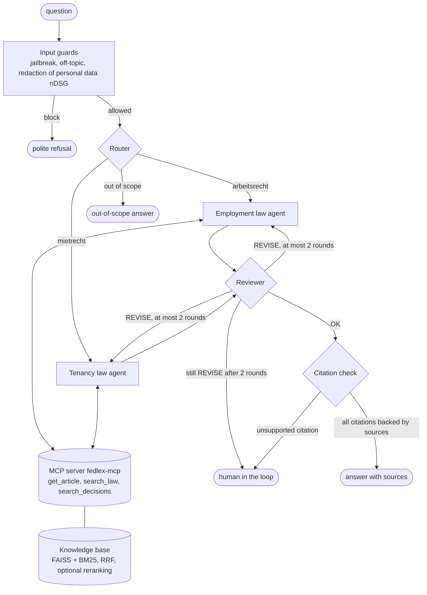
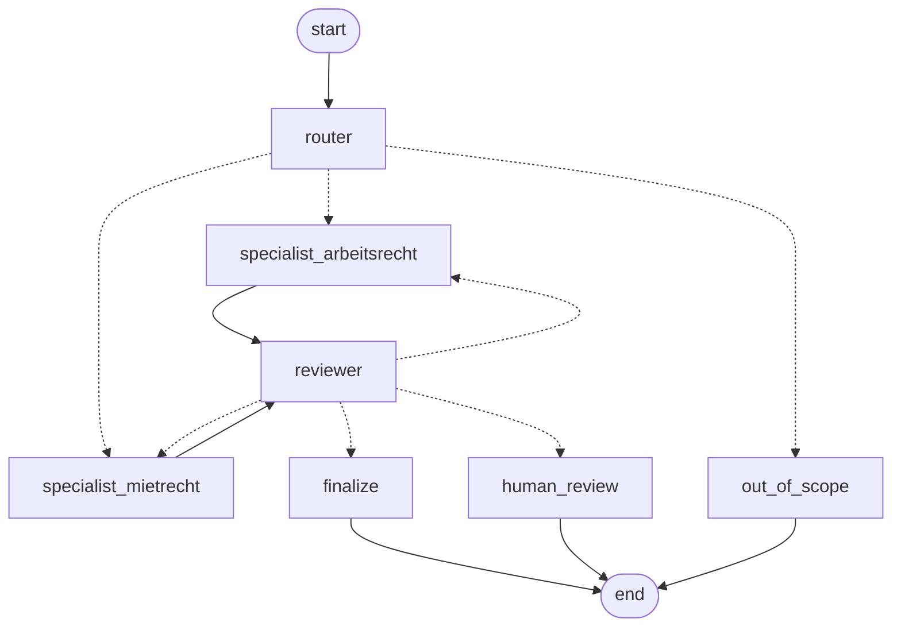

# Architecture

Source: notebook 00 (sections 2, 3 and 5), notebook 04 (graph) and notebook 05 (position of the guards).

A lawyer types in a case. A router agent identifies the area of law. A specialist agent pulls the relevant
statutory articles from the knowledge base and drafts an answer (applicable norm, subsumption, result) with
sources. A reviewer agent checks the draft and sends it back when something is missing. Uncertain cases go to a
human. A deterministic citation check blocks invented references before the user sees them.

## Target flow

The routing back from the citation check (to the reviewer or straight to a human) is an open question in
notebook 05 ("Your turn"). The diagram shows the variant from notebook 00 (uncertain goes to a human).

## What the code implements today

`lexgraph.agents.graph.build_graph` compiles this LangGraph graph (generated with `draw_mermaid()`). Since T14
(16 Oct 2026) there are two specialist nodes, one per area, sharing `SPECIALIST_PROMPT` and differing in
`AREA_GUIDANCE`. With a checkpointer, `human_review` pauses with `interrupt()` until a person approves, edits or
rejects the draft.

Not yet wired together (see the `TODO (Txx)` markers in the code):

- The graph uses the interim keyword retriever from notebook 04, not `retrieve()` or the MCP tools (T10).
- Human in the loop works in code and tests; the Gradio UI (T15) still has to show the paused draft and send the decision.
- MCP server (T13, 16 Oct 2026): `search_law` uses the shared `retrieve()` (hybrid with `LITELLM_API_KEY`, BM25 without) and filters by area; `search_decisions` answers `found: False`, BGE stays optional. The graph does not call the MCP tools yet, it still uses the keyword retriever (T10).
- The UI calls a placeholder `run_pipeline` instead of input guard, graph and citation check (T15).
- The knowledge base holds six paraphrased placeholder records, not the Fedlex text (T11).

## Building blocks

| Building block | Module | Notebook | Owner |
|---|---|---|---|
| Purpose & scope | `docs/` | 00 | Jack |
| LLM selection | `lexgraph/config.py` | 01 | Tim |
| Knowledge & RAG | `lexgraph/rag/` (`ingest.py`, `retrieval.py`), `data/` | 02 | Jack |
| Tools & MCP | `mcp_server/fedlex_server.py` | 03 | Tim |
| Orchestration | `lexgraph/agents/` (`state.py`, `prompts.py`, `graph.py`) | 04 | Tim |
| Safeguarding | `lexgraph/guardrails/` (`input_guard.py`, `citation_check.py`) | 05 | Tim |
| Testing & evaluation | `lexgraph/eval/` (`metrics.py`, `judge.py`, `experiment.py`), `data/testset.jsonl` | 06 | Jack |
| User interface | `lexgraph/ui/app.py` | 07 | Jack |

## Roles

Every building block has exactly one owner who decides and delivers. Supporting means reviewing, pairing and
stepping in when the owner is blocked. Every member must still be able to explain the whole system.

| Member | Role | Owns | Supports |
|---|---|---|---|
| Jack Ondoua | Product Lead & Knowledge Architect | Project lead, planning, coaching contact, presentation and submission. Knowledge base and RAG pipeline. Evaluation: test set, LLM-as-a-judge, F2, F4 and analysis of F1. Gradio UI, demo and the Deepnote project. | Agent prompts, citation check test cases |
| Tim Rusch | Agent Orchestration & Safety Engineer | LangGraph state, router, specialist agents, reviewer loop, human in the loop. MCP server `fedlex-mcp`. Model integration (LiteLLM, Apertus) and F1 runs. Guardrails and citation check. Tracing, GitHub repository, backup video. | Knowledge base & RAG, evaluation |

Code ownership on GitHub follows this table, see `.github/CODEOWNERS`.

## Stack

LangGraph and LangChain · FHNW LiteLLM proxy (OpenAI-compatible) for commercial and open models · Swiss AI
Platform for Apertus · Apertus Swiss embeddings · FAISS and BM25 · MCP (FastMCP server, `langchain-mcp-adapters`
client) · Gradio · LangSmith tracing.
